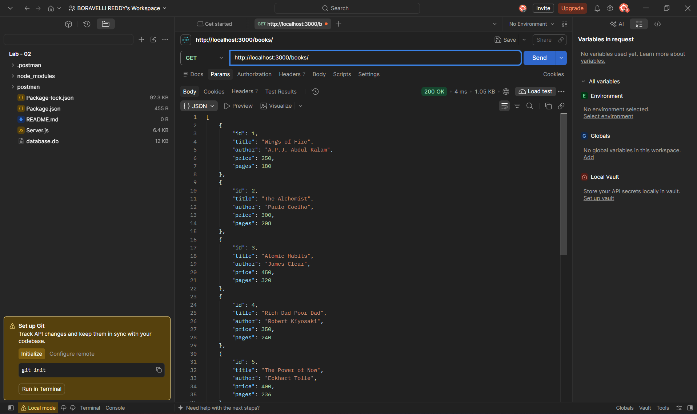
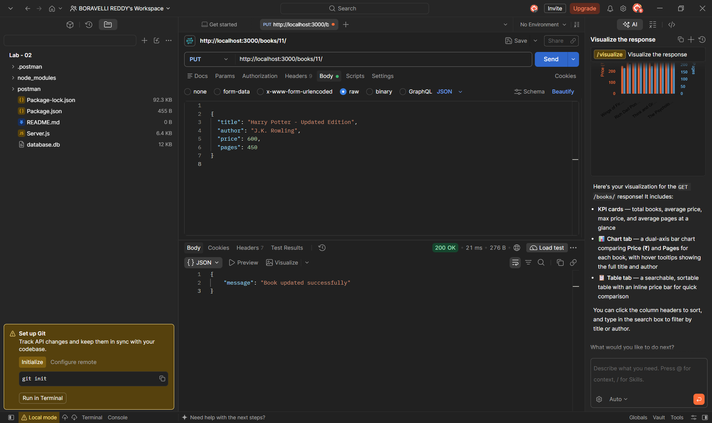

# Lab 02: SQLite Database and CRUD Routes

## Student Details

- **Name:** Sai Rashmitha
- **Registration Number:** 252U1R9056
- **GitHub Username:** Rashmitha1525
- **Section:** CSE (Gen-AI) 2A
- **Course:** Backend Development Fundamentals

## Objective

To develop a REST API using Node.js, Express.js, and SQLite database. The API performs CRUD (Create, Read, Update, Delete) operations on book records.

## Technologies Used

- Node.js
- Express.js
- SQLite
- JavaScript
- Postman
- Git and GitHub

## Installation

Clone the repository:

```bash
git clone https://github.com/Rashmitha1525/Lab---02.git
```

Move into the project folder:

```bash
cd Lab---02
```

Install dependencies:

```bash
npm install
```

## Running the Application

Start the server:

```bash
npm start
```

For development:

```bash
npm run dev
```

Server URL:

```text
http://localhost:3000/
```

## Database Details

Database Name: SQLite

Table Name: book

Fields:
- id
- title
- author
- price
- pages

## CRUD Operations

| Method | Endpoint | Description |
|---|---|---|
| GET | /books/ | Get all books |
| GET | /books/:id | Get a single book |
| POST | /books/ | Add a new book |
| PUT | /books/:id | Update a book |
| DELETE | /books/:id | Delete a book |

## Screenshots

### Get All Books


### Get Single Book


### Add Book


### Update Book


### Delete Book


## Problems Faced

- Setting up the SQLite database.
- Connecting the database with Express.js.
- Implementing CRUD operations.
- Testing API endpoints using Postman.
- Resolving Git merge conflicts while uploading the project.

## Conclusion

Successfully developed a Book Management REST API using Node.js, Express.js, and SQLite. Implemented all CRUD operations and tested the endpoints using Postman. Learned database connectivity, API development, and GitHub version control.
